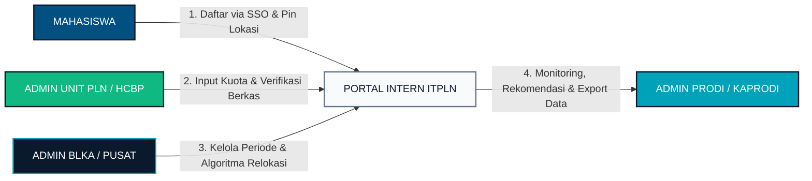
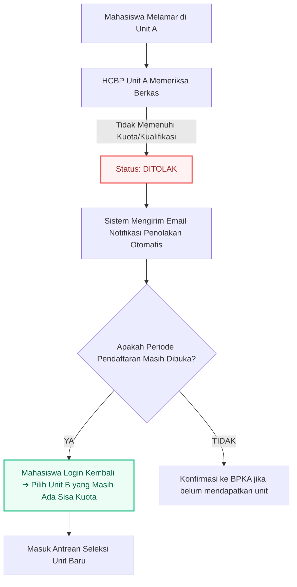
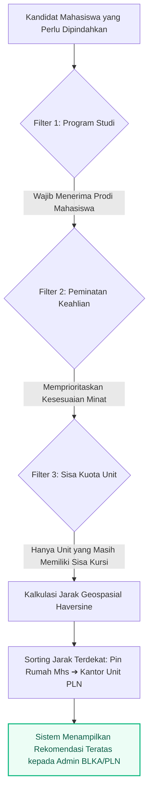

# SLIDE DECK MATERI PRESENTASI SOSIALISASI INTERN ITPLN (v2)

## Sistem Magang Terpadu — Institut Teknologi PLN × PT PLN (Persero)

### Audiensi Khusus: Kepala Program Studi & Tim Pengelola Akademik

---

## DAFTAR ISI SLIDE

- **Slide 1**: Judul & Agenda Pertemuan
- **Slide 2**: Evaluasi Sistem Lama vs Solusi INTERN ITPLN v2
- **Slide 3**: 3 Pilar Aktor Sistem (Mahasiswa, Unit PLN / BLKA, Admin Prodi)
- **Slide 4**: Siklus Hidup 4 Fase Periode Magang
- **Slide 5**: Fase Persiapan: Kuota Langsung vs Kuota Breakdown
- **Slide 6**: Mekanisme Filter Prodi Otomatis (Studi Kasus: S1 Teknik Informatika)
- **Slide 7**: Fase Pendaftaran: 5 Langkah Alur Mahasiswa
- **Slide 8**: Fase Seleksi: Verifikasi Unit & 4 Status Hasil Mahasiswa
- **Slide 9**: Mekanisme Penolakan & Hak Mendaftar Ulang
- **Slide 10**: Algoritma Cerdas Pemindahan Mahasiswa (Smart Relocation)
- **Slide 11**: Fase Pengumuman: E-Surat Pengantar QR Code & Kontak HCBP
- **Slide 12**: Portal Admin Prodi: Dashboard Monitoring & KPI
- **Slide 13**: Portal Admin Prodi: Tab Data Mahasiswa & Export Excel
- **Slide 14**: Portal Admin Prodi: Tab Formasi & Daya Serap Kuota Unit PLN
- **Slide 15**: Manfaat Strategis bagi Program Studi (CPL, IKU, Akreditasi)
- **Slide 16**: Roadmap Implementasi & Pembagian Akun Prodi

---

## SLIDE 1: JUDUL & AGENDA PERTEMUAN

### SOSIALISASI TATA KELOLA MAGANG TERPADU (INTERN ITPLN v2)

**Sinergi Kompetensi Program Studi dengan Formasi Nyata PT PLN (Persero) Se-Indonesia**

- **Penyelenggara**: Biro Layanan Karir dan Alumni (BLKA) ITPLN
- **Audiens**: Kepala Program Studi, Sekretaris Prodi, Koordinator Magang/KP
- **Platform**: Aplikasi Web Enterprise INTERN ITPLN v2 (Single Sign-On `@itpln.ac.id`)

#### Agenda Utama Presentasi:

1. Alur Sistem Global (Fase Persiapan ➔ Pendaftaran ➔ Seleksi ➔ Pengumuman).
2. Mekanisme Perlindungan Linieritas Prodi (Filter Otomatis & Kuota Terdedikasi).
3. Alur Pendaftaran, Penolakan, dan Algoritma Pemindahan Mahasiswa.
4. Pengenalan Fitur Portal Mandiri Admin Prodi (Monitoring, Advising, & Export Rekap).

---

## SLIDE 2: EVALUASI SISTEM LAMA VS SOLUSI SISTEM v2

### DARI PENEMPATAN MANUAL MENUJU EKOSISTEM DIGITAL PRESISI

| Masalah Penempatan Masa Lalu                                                                                          | Solusi Terintegrasi di INTERN ITPLN v2                                                                                     |
| :-------------------------------------------------------------------------------------------------------------------- | :------------------------------------------------------------------------------------------------------------------------- |
| **Salah Kamar / Tidak Linier**<br>Mahasiswa mendaftar bebas ke unit PLN yang tidak membutuhkan kompetensi jurusannya. | **Filter Prodi Otomatis**<br>Unit hanya dapat dipilih jika secara resmi membuka lowongan bagi prodi bersangkutan.          |
| **Kuota Tidak Transparan**<br>Prodi tidak tahu berapa jatah kursi riil untuk jurusannya di masing-masing unit.        | **Kuota Breakdown per Prodi**<br>Unit mengunci alokasi kuota khusus terdedikasi per program studi.                         |
| **Birokrasi Surat Manual**<br>Antrean panjang mahasiswa meminta cap basah Surat Pengantar ke fakultas/BLKA.           | **E-Surat Pengantar Otomatis**<br>Surat terbit otomatis ber-QR Code validasi publik saat pengumuman dibuka.                |
| **Lokasi Magang Jauh dari Rumah**<br>Mahasiswa ditempatkan jauh tanpa pertimbangan domisili, membebani biaya hidup.   | **Smart Placement (Pin Geospasial)**<br>Rekomendasi relokasi menghitung jarak terdekat dari pin alamat domisili mahasiswa. |

---

## SLIDE 3: TIGA PILAR AKTOR SISTEM

### PEMBAGIAN PERAN & HAK AKSES YANG JELAS DAN TERKONEKSI



#### Ringkasan Tanggung Jawab:

- **Mahasiswa**: Pendaftaran terverifikasi SSO kampus, melengkapi profil akademik, menentukan pin alamat di peta, memilih unit yang sesuai prodinya.
- **Admin Unit PLN (HCBP)**: Menentukan formasi kuota prodi, memeriksa berkas pelamar, menetapkan status kelulusan (Terima/Tolak).
- **Admin BLKA**: Membuka periode, memvalidasi kuota nasional, menjalankan algoritma pemindahan pendaftar.
- **Admin Prodi (Kaprodi)**: Memantau pergerakan pendaftaran mahasiswa, memonitor ketersediaan kuota unit, memberikan rekomendasi unit, dan mengunduh rekapitulasi data.

---

## SLIDE 4: SIKLUS HIDUP 4 FASE PERIODE MAGANG

### ALUR WAKTU TERSTRUKTUR DARI PERSIAPAN HINGGA PENERBITAN SURAT

```
[FASE 1: PERSIAPAN] ──> [FASE 2: PENDAFTARAN] ──> [FASE 3: SELEKSI & PINDAH] ──> [FASE 4: PENGUMUMAN]
• BLKA Buka Periode     • Mahasiswa Akses Web     • HCBP Verifikasi Berkas       • Pengumuman Dibuka
• Default: PERSIAPAN    • Filter Otomatis Prodi   • 4 Status: Proses / Terima /  • E-Surat Terbit Otomatis
• Unit Input Kuota      • Pin Peta Domisili         Tolak / Dipindahkan          • Kontak HCBP Muncul
  (Langsung/Breakdown)  • Reservasi Kuota 5 Menit • Tolak ➔ Email + Re-apply     • Prodi Unduh Rekap
• Mapping Prodi & Minat • Submit Pendaftaran      • Algoritma Smart Placement      Excel (.xlsx)
```

#### Aturan Pengamanan Sistem:

1. **Pendaftaran Terkunci pada Fase Persiapan**: Mahasiswa belum bisa memilih unit sebelum formasi kuota selesai divalidasi.
2. **Reservasi Kursi 5 Menit**: Mencegah benturan rebutan kuota pada detik yang sama (_race condition_).
3. **Pemberitahuan Instan**: Mahasiswa yang ditolak langsung menerima email resmi dan dapat memilih unit lain.

---

## SLIDE 5: FASE PERSIAPAN — KUOTA LANGSUNG VS KUOTA BREAKDOWN

### KEPASTIAN ALOKASI KURSI MAGANG UNTUK MASING-MASING PRODI

```
┌─────────────────────────────────────────────────────────────────────────────┐
│                          MODEL KUOTA UNIT KERJA PLN                         │
├───────────────────────────────────────┬─────────────────────────────────────┤
│         KUOTA LANGSUNG (UMUM)         │    KUOTA BREAKDOWN (TERDEDIKASI)    │
├───────────────────────────────────────┼─────────────────────────────────────┤
│ • Terbuka untuk seluruh jurusan yang  │ • Kuota dikunci khusus untuk satu   │
│   diizinkan oleh Unit PLN.            │   program studi tertentu.           │
│ • Bersifat kompetitif antar-jurusan   │ • Mahasiswa prodi lain TIDAK DAPAT  │
│   yang dicentang.                     │   mengambil kursi ini.              │
│                                       │                                     │
│ Contoh:                               │ Contoh:                             │
│ PLN UID Jaya membuka Kuota Langsung = │ PLN Icon Plus mengunci Breakdown:   │
│ 15 kursi (Dapat diperebutkan bersama  │ - S1 Teknik Informatika : 5 Kursi   │
│ oleh TI, SI, dan Teknik Elektro).     │ - S1 Sistem Informasi   : 3 Kursi   │
│                                       │ - S1 Bisnis Digital     : 2 Kursi   │
└───────────────────────────────────────┴─────────────────────────────────────┘
```

#### Komponen Formasi yang Diisi Unit PLN pada Fase Persiapan:

1. **Status Kesediaan Unit**: Aktif menerima / tidak menerima pada periode berjalan.
2. **Model Kuota**: Langsung atau Breakdown per Program Studi.
3. **Daftar Program Studi yang Diterima**: Pemilihan fakultas dan jenjang prodi.
4. **Daftar Peminatan Keahlian**: Bidang kompetensi spesifik yang dicari unit.

---

## SLIDE 6: OTOMASI FILTER PRODI

### STUDI KASUS: MAHASISWA S1 TEKNIK INFORMATIKA

```
[Akun Mahasiswa Terdeteksi: S1 TEKNIK INFORMATIKA]

DAFTAR UNIT YANG TAMPIL DI LAYAR MAHASISWA (LOLOS FILTER):
[✓] PT PLN (Persero) Divisi Teknologi Informasi Pusat     ➔ Buka Formasi S1 TI (Sisa: 4)
[✓] PT Indonesia Comnets Plus (PLN Icon Plus)             ➔ Buka Formasi S1 TI (Sisa: 5)
[✓] PLN UID Jakarta Raya - Bidang Sistem Informasi        ➔ Buka Formasi S1 TI (Sisa: 2)

DAFTAR UNIT YANG OTOMATIS TERSEMBUNYI (TIDAK MEMBUKA S1 TI):
[X] PLN UP3 Ciracas - Pemeliharaan Trafo Gardu Induk     ➔ Hanya menerima Teknik Elektro
[X] PLN Indonesia Power Priok - Pemeliharaan Turbin      ➔ Hanya menerima Teknik Mesin
```

#### Keuntungan bagi Program Studi:

- **Zero Salah Kamar**: Tidak ada lagi mahasiswa tersesat di unit yang tidak relevan dengan bidang ilmu.
- **Relevansi Capaian Pembelajaran Lulusan (CPL)**: Seluruh tugas magang sejalan dengan kurikulum prodi.
- **Mempermudah Konversi SKS**: Mempercepat proses persetujuan konversi nilai MBKM/KRS di tingkat prodi.

---

## SLIDE 7: FASE PENDAFTARAN — ALUR 5 LANGKAH MAHASISWA

### PROSES PENDAFTARAN MAHASISWA YANG TERTIB DAN TEPAT SASARAN

```
┌───────────────┐     ┌───────────────┐     ┌───────────────┐     ┌───────────────┐     ┌───────────────┐
│    STEP 1     │ ──> │    STEP 2     │ ──> │    STEP 3     │ ──> │    STEP 4     │ ──> │    STEP 5     │
│ Pilih Program │     │ Data Diri &   │     │ Pin Lokasi    │     │ Pilih Unit    │     │ Resume &      │
│ (1, 3, 5 Bln) │     │ Peminatan     │     │ Domisili Peta │     │ & Reservasi   │     │ Kirim Berkas  │
└───────────────┘     └───────────────┘     └───────────────┘     └───────────────┘     └───────────────┘
  * Cek Syarat IPK      * Nama, NIM, No WA    * Peta Leaflet GPS    * Unit Sesuai Prodi   * Timer Kuota
    & SKS Otomatis        CV, Portofolio,       Presisi Koordinat   * Tahan Kursi           5 Menit
    (Syarat 5 Bln:        LinkedIn Link         (Latitude/Longitude)  5 Menit             * Final Submit
    IPK>=3.0, SKS>=110) * Maks 3 Minat
```

#### Validasi Berlapis di Formulir:

- **Penyaringan IPK & SKS Real-Time**: Mahasiswa yang belum memenuhi syarat SKS program 5 bulan langsung diberi peringatan sistem.
- **Penentuan Pin Geospasial**: Mahasiswa menandai titik koordinat tempat tinggal (rumah/kost) secara akurat pada peta digital.
- **Timer Reservasi Kuota**: Kuota unit pilihan terkunci selama 5 menit saat mahasiswa meninjau berkas resume di langkah terakhir.

---

## SLIDE 8: FASE SELEKSI — VERIFIKASI UNIT & 4 STATUS HASIL

### PENILAIAN LANGSUNG OLEH HCBP UNIT DENGAN STATUS TRANSPARAN

```
┌──────────────────────────────┬─────────────────────────────────────────────────────────────────────────────┐
│ STATUS SELEKSI               │ DEFINISI & KONSEKUENSI BAGI MAHASISWA                                       │
├──────────────────────────────┼─────────────────────────────────────────────────────────────────────────────┤
│ 1. SEDANG DIPROSES           │ Berkas telah masuk sistem dan sedang dalam antrean verifikasi oleh tim      │
│                              │ Unit PLN atau tim BLKA.                                                     │
├──────────────────────────────┼─────────────────────────────────────────────────────────────────────────────┤
│ 2. DITERIMA                  │ Mahasiswa dinyatakan LOLOS seleksi pada Unit PLN pilihan utama.             │
│                              │ Berhak mengunduh Surat Pengantar saat pengumuman dibuka.                    │
├──────────────────────────────┼─────────────────────────────────────────────────────────────────────────────┤
│ 3. DITOLAK                   │ Berkas mahasiswa tidak memenuhi syarat unit atau kuota utama telah penuh.   │
│                              │ >> Mahasiswa menerima EMAIL otomatis & BISA DAFTAR ULANG ke unit lain
selama periode tersebut masih terbuka. <<   │
├──────────────────────────────┼─────────────────────────────────────────────────────────────────────────────┤
│ 4. DIPINDAHKAN / CADANGAN    │ Mahasiswa direlokasi ke Unit PLN alternatif       │
│                              │ dan rekomendasi Algoritma Cerdas (Smart Placement).                         │
└──────────────────────────────┴─────────────────────────────────────────────────────────────────────────────┘
```

#### Pelaksana Verifikasi:

- Dilakukan oleh **Assistant Manager HCBP / PIC Unit PLN** melalui portal perusahaan (`/perusahaan/index.html`).
- Menilai kesesuaian berkas: CV, Portofolio, Transkrip Akademik, dan Link LinkedIn.

---

## SLIDE 9: MEKANISME PENOLAKAN & HAK DAFTAR ULANG

### SISTEM PERLINDUNGAN MAHASISWA: KESEMPATAN KEDUA PADA PERIODE BERJALAN



#### Keunggulan Dibandingkan Sistem Manual:

1. **Notifikasi Seketika (_Real-Time Alert_)**: Mahasiswa tidak digantung hingga akhir semester; penolakan diinfokan via email resmi seketika.
2. **Tidak Hangus**: Mahasiswa berhak mendaftar ulang ke unit lain selama periode pendaftaran masih dibuka.
3. **Penyelamatan Kuota**: Kuota di unit-unit yang masih kosong dapat segera diserap oleh mahasiswa yang mendaftar ulang.

---

## SLIDE 10: ALGORITMA CERDAS PEMINDAHAN (SMART RELOCATION)

### LOGIKA ILMIAH PENEMPATAN MAHASISWA YANG BELUM TERTAMPUNG



#### 4 Parameter Utama Algoritma Rekomendasi:

1. **Kesesuaian Jurusan**: Unit tujuan wajib terdaftar menerima prodi mahasiswa.
2. **Kesesuaian Peminatan**: Dicocokkan dengan pilihan peminatan saat mendaftar.
3. **Ketersediaan Kuota**: Hanya unit dengan sisa kuota $\ge 1$ yang diusulkan.
4. **Jarak Terdekat (Haversine Formula)**: Mengukur jarak radius koordinat dari pin rumah mahasiswa ke kantor unit PLN:
   $$\text{Jarak} = 2R \cdot \arcsin\left(\sqrt{\sin^2\left(\frac{\Delta\text{lat}}{2}\right) + \cos(\text{lat}_1)\cos(\text{lat}_2)\sin^2\left(\frac{\Delta\text{lon}}{2}\right)}\right)$$

- **Tujuan Akhir**: Penempatan adil, obyektif, dan meminimalisir beban biaya kos mahasiswa.

---

## SLIDE 11: FASE PENGUMUMAN — E-SURAT PENGANTAR & KONTAK HCBP

### INTEGRASI ADMINISTRASI KAMPUS DENGAN ONBOARDING INDUSTRI

```
┌─────────────────────────────────────────────────────────────────────────────┐
│ DASHBOARD PENGUMUMAN MAHASISWA                                              │
├─────────────────────────────────────────────────────────────────────────────┤
│ STATUS: DITERIMA MAGANG                                                     │
│ Lokasi Unit : PT PLN (Persero) Pusmanpro - Jakarta                          │
│ Durasi      : 5 Bulan KRS (Semester Ganjil 2026/2027)                       │
│                                                                             │
│ [ UNDUH SURAT PENGANTAR RESMI (.PDF) ]                                      │
│ Fitur Surat:                                                                │
│ • Nomor Surat Resmi Kampus Terbit Otomatis                                  │
│ • Kop Resmi Institut Teknologi PLN & Tanda Tangan Digital                   │
│ • QR-Code Verifikasi Publik (Bisa dipindai Satpam/HCBP Unit untuk cek asli)│
├─────────────────────────────────────────────────────────────────────────────┤
│ INFORMASI NARAHUBUNG / HCBP UNIT TUJUAN:                                    │
│ • Nama PIC HCBP   : Ibu Rina Wulandari (Asman HCBP)                         │
│ • No. WhatsApp    : 0812-XXXX-XXXX                                          │
│ • Email Resmi     : rina.wulandari@pln.co.id                                │
│ • Alamat Lapor Diri: Jl. Duren Tiga Raya No. 102, Jakarta Selatan           │
└─────────────────────────────────────────────────────────────────────────────┘
```

#### Manfaat Operasional:

- Mahasiswa **tidak perlu lagi antre** di loket kampus untuk mengurus surat pengantar fisik.
- Mahasiswa memiliki **kepastian narahubung** saat melapor diri di hari pertama magang.

---

## SLIDE 12: PORTAL ADMIN PRODI — DASHBOARD & KPI MONITORING

### RUANG KENDALI MANDIRI UNTUK KEPALA PROGRAM STUDI (`/admin/prodi/index.html`)

```
┌───────────────────────────────────────────────────────────────────────────────────────────┐
│ INTERN ITPLN — PORTAL PROGRAM STUDI                          [👤 Kaprodi Teknik Informatika] │
├───────────────────────────────────────────────────────────────────────────────────────────┤
│ Periode Aktif: Semester Ganjil 2026/2027  [STATUS: DIBUKA]             [Export Rekap Excel]│
├───────────────────────────────────────────────────────────────────────────────────────────┤
│ ┌────────────────┐ ┌────────────────┐ ┌────────────────┐ ┌────────────────┐ ┌──────────┐ │
│ │TOTAL PENDAFTAR │ │LOLOS (DITERIMA)│ │SEDANG DIPROSES │ │CADANGAN/PINDAH │ │ DITOLAK  │ │
│ │      84        │ │       42       │ │       30       │ │       7        │ │    5     │ │
│ └────────────────┘ └────────────────┘ └────────────────┘ └────────────────┘ └──────────┘ │
│                                                                                           │
│ ANALITIK GRAFIK REAL-TIME:                                                                │
│ 1. Sebaran Durasi Program (1 Bulan vs 3 Bulan vs 5 Bulan KRS)                             │
│ 2. Top Unit PLN Paling Diminati Mahasiswa Prodi Ini                                       │
│ 3. Sebaran Pilihan Peminatan Bidang Keahlian                                              │
│ 4. Daftar 5 Pendaftar Terbaru dari Prodi                                                  │
└───────────────────────────────────────────────────────────────────────────────────────────┘
```

#### Karakteristik Akun Admin Prodi:

- **Privasi Ketat Antar-Jurusan**: Kaprodi hanya melihat data mahasiswa dari program studinya sendiri.
- **Bebas Beban Verifikasi Teknis**: Kaprodi tidak diwajibkan memeriksa dokumen satu per satu; tugas utama difokuskan pada pengawasan (_supervisory_) dan bimbingan (_advising_).

---

## SLIDE 13: PORTAL ADMIN PRODI — TAB DATA MAHASISWA & EXPORT EXCEL

### PENGAWASAN RINCI PROFIL MAHASISWA DAN KEBUTUHAN REKAPITULASI CEPAT

```
┌───────────────────────────────────────────────────────────────────────────────────────────┐
│ TAB 2: DATA MAHASISWA PRODI                                                               │
├───────────────────────────────────────────────────────────────────────────────────────────┤
│ [Cari NIM / Nama...]  [Filter: Semua Status ▼]  [Filter: Semua Program ▼]  [Reset Filter] │
├────┬───────────────┬──────┬─────────┬─────────┬──────────────┬───────────────┬────────────┤
│ NO │ NAMA / NIM    │ L/P  │ ANGKATAN│ IPK/SKS │ PROGRAM      │ UNIT PILIHAN  │ STATUS     │
├────┼───────────────┼──────┼─────────┼─────────┼──────────────┼───────────────┼────────────┤
│ 1  │ Gangsar       │ L    │ 2024    │ 3.75/115│ 5 Bulan KRS  │ PLN Icon Plus │ Diterima   │
│ 2  │ Amanda P.     │ P    │ 2024    │ 3.40/112│ 5 Bulan KRS  │ Divisi IT Pst │ Diproses   │
│ 3  │ Budi Santoso  │ L    │ 2023    │ 2.95/98 │ 1 Bulan Reg  │ UP3 Ciracas   │ Ditolak    │
└────┴───────────────┴──────┴─────────┴─────────┴──────────────┴───────────────┴────────────┘
```

#### Fitur-Fitur Unggulan Tab Mahasiswa:

- **Modal Detail Mahasiswa**: Klik aksi untuk menginspeksi alamat rumah, riwayat unit, berkas CV, portofolio, dan akun LinkedIn mahasiswa.
- **Tombol "Export Rekap Excel"**: Sekali klik untuk mengunduh seluruh data pendaftar prodi ke format `.xlsx` (siap digunakan untuk rapat pimpinan, yudisium, dan borang akreditasi).

---

## SLIDE 14: PORTAL ADMIN PRODI — TAB FORMASI & KUOTA UNIT PLN

### MEMANTAU UNIT AKTIF DAN MEMBANTU MENGARAHKAN MAHASISWA

```
┌───────────────────────────────────────────────────────────────────────────────────────────┐
│ TAB 3: FORMASI & KUOTA UNIT PLN UNTUK PROGRAM STUDI INI                                   │
├───────────────────────────────────────────────────────────────────────────────────────────┤
│ [Cari Nama Unit / Kota...]   [Filter Tipe: Semua / Breakdown Khusus Prodi / Umum ▼]       │
├────┬─────────────────────────────┬─────────────┬───────────┬──────────┬──────────┬────────┤
│ NO │ NAMA UNIT PLN               │ WILAYAH     │ TIPE      │ KUOTA    │ SISA     │ PELAMAR│
├────┼─────────────────────────────┼─────────────┼───────────┼──────────┼──────────┼────────┤
│ 1  │ PT PLN Icon Plus Gandul     │ Depok       │ Breakdown │ 5 Kursi  │ 1 Kursi  │ 8 Mhs  │
│ 2  │ Divisi IT Kantor Pusat      │ Jakarta     │ Breakdown │ 4 Kursi  │ 3 Kursi  │ 2 Mhs  │
│ 3  │ PLN UID Jaya - Bagian IT    │ Jakarta     │ Umum      │ 10 Kursi │ 6 Kursi  │ 5 Mhs  │
│ 4  │ PLN PUSMANPRO               │ Jakarta     │ Breakdown │ 3 Kursi  │ 3 Kursi  │ 0 Mhs  │
└────┴─────────────────────────────┴─────────────┴───────────┴──────────┴──────────┴────────┘
```

#### Nilai Praktis bagi Kaprodi:

- **Fungsi Advising Mahasiswa**: Jika mahasiswa bingung memilih unit, Kaprodi dapat melihat unit mana yang masih menyisakan banyak kuota (contoh: PUSMANPRO masih sisa 3 kursi).
- **Evaluasi Kemitraan**: Mengetahui unit PLN mana saja yang aktif menyerap mahasiswa dari prodi bersangkutan.

---

## SLIDE 15: MANFAAT STRATEGIS BAGI PROGRAM STUDI

### TIGA DAMPAK UTAMA PADA INDIKATOR KINERJA AKADEMIK KAMPUS

```
┌──────────────────────────────┬──────────────────────────────┬──────────────────────────────┐
│       PENCAPAIAN IKU         │    REKOGNISI KURIKULUM       │      EFISIENSI WAKTU         │
├──────────────────────────────┼──────────────────────────────┼──────────────────────────────┤
│ • Mendukung IKU 2:           │ • Menjamin mahasiswa magang  │ • Menghilangkan pekerjaan    │
│   Peningkatan jumlah         │   pada unit kerja yang       │   manual surat-menyurat di   │
│   mahasiswa berkegiatan di   │   linier dengan CPL prodi.   │   tata usaha prodi.          │
│   luar kampus.               │                              │                              │
│                              │ • Landasan konversi 20 SKS   │ • Rekap data akreditasi      │
│ • Mendukung IKU 6:           │   magang 5 bulan menjadi sah │   tersedia otomatis dalam    │
│   Kemitraan nyata prodi      │   dan akuntabel.             │   format Excel (.xlsx).      │
│   dengan PLN Group.          │                              │                              │
└──────────────────────────────┴──────────────────────────────┴──────────────────────────────┘
```

---

## SLIDE 16: ROADMAP IMPLEMENTASI & TANYA JAWAB

### LANGKAH BERSAMA MENUJU PEMBUKAAN PERIODE MAGANG

```
┌───────────────────────────────────────────────────────────────────────────────────────────┐
│ JADWAL PELAKSANAAN:                                                                       │
├────────────────────┬────────────────────┬────────────────────┬────────────────────────────┤
│ MINGGU INI         │ H - 7 HARI         │ HARI - H           │ PASCA PENGUMUMAN           │
│ Pembagian Akun     │ Sosialisasi Prodi  │ Pembukaan Periode  │ Monitoring Mahasiswa &     │
│ Kredensial Prodi   │ ke Mahasiswa       │ Pendaftaran Mahasiswa Unduh Laporan Rekap       │
└────────────────────┴────────────────────┴────────────────────┴────────────────────────────┘
```

#### Cara Login Admin Prodi:

1. Kunjungi: `https://intern.itpln.ac.id/admin/login.html`
2. Masukkan Username & Password Admin Prodi masing-masing jurusan.
3. Sistem otomatis mengarahkan ke dashboard prodi Anda: `/admin/prodi/index.html`.

---

### SESI TANYA JAWAB (Q&A)

**Biro Layanan Karir dan Alumni (BLKA) ITPLN**

- _Helpdesk Teknis & Layanan Admin_: Gedung Rektorat ITPLN Lantai 1 / Email: `blka@itpln.ac.id`
- _Aplikasi_: [INTERN ITPLN Portal Prodi](http://localhost:8000/admin/prodi/index.html)
